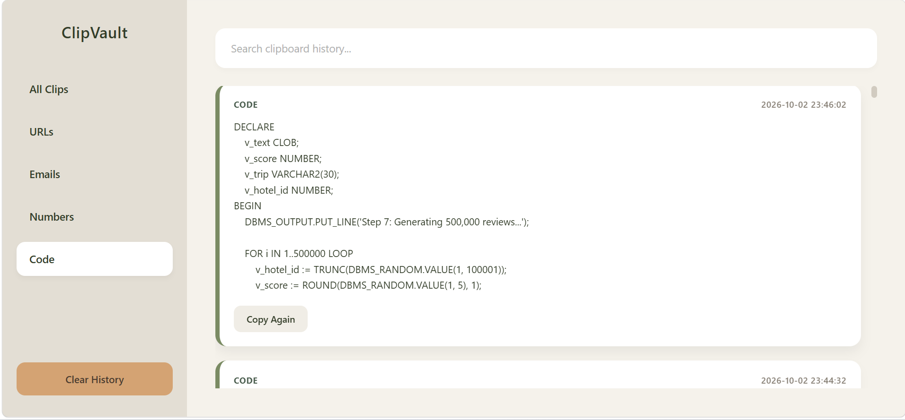

# ClipVault: Smart Clipboard Manager

A full-stack, local-first web application that monitors the system clipboard in real-time, intelligently categorizes copied text, and stores the content in a searchable database.

A common issue in modern computing is the loss of clipboard data after subsequent copy actions. ClipVault addresses this problem by running silently in the background, capturing all copied content, and organizing the data into a searchable web interface.

# How It Works 
* The Background Thread: Upon execution of the main script, a daemon thread starts in the background. The system clipboard is checked every second.

* Smart Tagging: When new text is detected, a Regex function classifies the content and saves the data to the SQLite database.

* The Web Server: Flask runs a local server on port 5000.

* The Frontend Polling: The HTML page uses JavaScript fetch() combined with a setInterval() function. Every 3 seconds, the frontend requests the latest data from the Flask server and dynamically updates the user interface without refreshing the page.

## Demo Preview



## Key Features

- Real-Time Monitoring: Continuously captures clipboard events without interrupting existing workflows.

- Intelligent Categorization: Utilizes Regular Expressions (Regex) to automatically classify entries as URLs, Emails, Contact Numbers, Code, Hex Colors, Numbers, or Plain Text.

- Automated UI Refresh: The frontend interface automatically synchronizes with the backend database every 3 seconds, ensuring newly copied text appears almost instantly without requiring a manual browser refresh.

- Persistent Data Storage: Saves the entire history to a local SQLite database, ensuring data survival across browser and system restarts.

- Modern User Interface: A responsive, single-page application built with HTML, CSS, and Vanilla JavaScript, featuring a custom olive and beige color palette.

- Instant Search and Filtering: Historical items are quickly retrieved using the real-time search bar or category filters.

- Privacy-First Architecture: Operates 100% offline. No data is transmitted to external servers or third parties.

## Technical Limitations and Constraints

To maintain a secure and privacy-first architecture, the project has the following constraints:

- Local-First Architecture: Due to strict browser security policies (CORS and sandbox restrictions), modern web browsers block websites from accessing the system clipboard in the background. Therefore, this application cannot be deployed to a public web server. The application must be run locally on the host machine.
- Environment Dependency: This is a Python-based utility. A local Python installation and terminal execution are required. The application is not distributed as a standalone executable file.
- Linux Clipboard Dependencies: As with most Python clipboard utilities on Linux, external package dependencies (such as xclip) may be required for the clipboard monitoring to function properly.

## Tech Stack

Backend (The Engine):
- Python 3.13 - Core programming language
- Flask - Web framework to serve the frontend and REST API
- SQLite3 - Embedded database for persistent storage
- Threading - Runs the clipboard monitor asynchronously without blocking the web server
- Pyperclip - Cross-platform library for reading the system clipboard

Frontend (The Interface):
- HTML5 - Semantic structure of the web page
- CSS3 - Custom olive and beige styling, flexbox layout, and animations
- Vanilla JavaScript - Fetch API integration, dynamic DOM rendering, search functionality, and a setInterval loop for automated 3-second UI polling

## Project Structure

```text
SmartClip AI/
│
├── clipvault.py          # Main Python backend (Flask server + Clipboard monitor)
├── requirements.txt      # List of Python dependencies
├── .gitignore            # Prevents tracking of the local SQLite database
├── README.md             # Project documentation
├── screenshot.png        # (Optional) Project screenshot
│
├── templates/            # HTML Files
│   └── index.html        # The web page structure
│
└── static/               # Static Assets
    └── style.css         # The styling